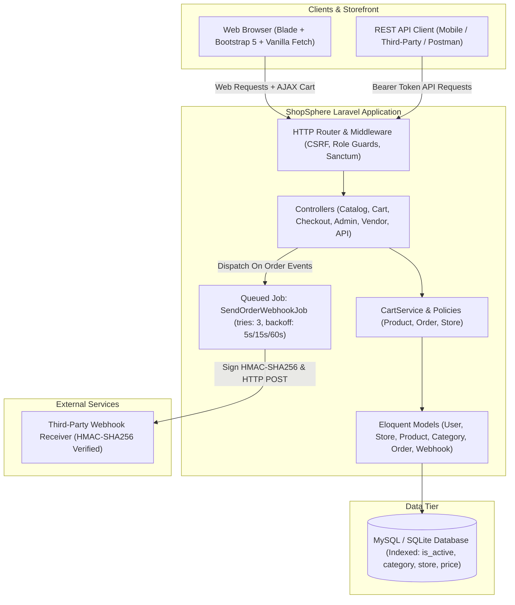

# ShopSphere

A multi-vendor e-commerce platform built with PHP 8.2+ and Laravel. ShopSphere supports three distinct user roles (admin, vendor, customer) with separate panels, dynamic catalog filtering over indexed tables, an AJAX-driven shopping cart, checkout and order status tracking, a Sanctum-authenticated REST API, and signed outgoing order webhooks executed through queue workers with exponential retry backoff.

---

## Features

- **Multi-Role Architecture**:
  - **Admin**: Platform oversight, revenue and order analytics, catalog-wide moderation, vendor store status toggles, and webhook endpoint management.
  - **Vendor**: Merchant portal with sales metrics, store profile settings, catalog management (create, update, delete, stock controls), and item fulfillment tracking.
  - **Customer**: Storefront browsing, cart drawer, checkout workflow, order history, and order status tracking with cancellation options.
- **Catalog Filtering & Pagination**:
  - Filter by keyword (name and description), category, vendor store, price range, and in-stock availability.
  - Sort by latest, price (asc/desc), or name.
  - Eloquent eager loading (`category`, `store`) prevents N+1 queries.
  - Database composite indexes on `[is_active, category_id, price]` and `[is_active, store_id]`.
  - Bulk seeder capable of inserting 10,000 products in 0.27 seconds.
- **AJAX Shopping Cart**:
  - Session-backed cart supporting asynchronous add, quantity updates, item deletion, and clearing.
  - Real-time stock validation preventing backorders beyond on-hand inventory.
  - Dynamic navbar badge updates and toast alerts without full page reloads.
- **Checkout & Order Workflow**:
  - Atomic checkout handled inside database transactions with row-level locks.
  - Immediate stock decrements upon purchase.
  - Life cycle states: `pending` -> `processing` -> `shipped` -> `delivered` (or `cancelled`).
  - Item restoration to inventory upon customer cancellation.
- **Outgoing Order Webhooks**:
  - Dispatches `order.created` and `order.updated` events to registered endpoints.
  - Handled via Laravel's `SendOrderWebhookJob` queue worker with 3 attempts and exponential backoff (`[5, 15, 60]` seconds).
  - Webhook payloads are signed using HMAC-SHA256 (`X-ShopSphere-Signature` header).
  - All delivery attempts, HTTP response statuses, and payloads are logged in the database.
- **Sanctum REST API**:
  - Token-based authentication (`/api/v1/auth/login`, `/api/v1/auth/register`, `/api/v1/auth/logout`, `/api/v1/auth/user`).
  - Full CRUD endpoints for products and orders with policy-based authorization.
- **Security**:
  - CSRF protection enabled across all forms and AJAX requests.
  - Zero raw string SQL: all queries use parameterized Eloquent and query builder methods.
  - Authorization enforced using Laravel Policies (`ProductPolicy`, `OrderPolicy`, `StorePolicy`) and Form Requests.

---

## Tech Stack

- **Backend**: PHP 8.2+ / 8.4, Laravel 11 (Eloquent ORM, Form Requests, Policies, Queues)
- **Database**: MySQL 8.0 (Docker / production), SQLite in-memory (automated test suites)
- **Frontend**: Blade templates, Bootstrap 5.3, Bootstrap Icons, Vanilla JavaScript (`fetch` API)
- **API Authentication**: Laravel Sanctum (Bearer tokens)
- **Queue & Webhooks**: Laravel Queues with database/sync drivers, Guzzle / HTTP Client
- **Containerization**: Docker & Docker Compose
- **Testing & CI**: PHPUnit 11 (51 automated feature tests), GitHub Actions CI matrix (`8.2`, `8.3`, `8.4`)

---

## Architecture Diagram



---

## Project Structure

```
.
├── app/
│   ├── Console/Commands/
│   │   └── SeedCatalogCommand.php     # Custom artisan shop:seed-catalog command
│   ├── Http/
│   │   ├── Controllers/
│   │   │   ├── Admin/                 # Dashboard, products, orders, vendors, webhooks
│   │   │   ├── Api/                   # Sanctum API: Auth, Products, Orders
│   │   │   ├── Customer/              # Customer order tracking and cancellation
│   │   │   ├── Vendor/                # Vendor merchant portal, products, orders, store
│   │   │   ├── AuthController.php     # Web login, registration, logout
│   │   │   ├── CartController.php     # AJAX & web cart endpoints
│   │   │   ├── CatalogController.php  # Public storefront and product details
│   │   │   └── CheckoutController.php # Checkout processing and confirmation
│   │   ├── Middleware/
│   │   │   └── EnsureUserHasRole.php  # Role-based route guard (admin, vendor, customer)
│   │   └── Requests/                  # Form request validation classes
│   ├── Jobs/
│   │   └── SendOrderWebhookJob.php    # Queued webhook job with backoff and HMAC signature
│   ├── Models/                        # User, Store, Category, Product, Order, OrderItem, Webhooks
│   ├── Policies/                      # ProductPolicy, OrderPolicy, StorePolicy
│   └── Services/
│       └── CartService.php            # Session cart logic and stock verification
├── database/
│   ├── migrations/                    # Schema migrations with foreign keys and composite indexes
│   └── seeders/                       # DatabaseSeeder, LargeCatalogSeeder (~10k products)
├── resources/
│   └── views/                         # Blade templates (catalog, cart, checkout, admin, vendor, customer)
├── routes/
│   ├── api.php                        # Sanctum REST API routes (/api/v1/...)
│   └── web.php                        # Web storefront, cart, checkout, admin, vendor routes
├── tests/
│   ├── Feature/                       # AuthTest, CartTest, CheckoutTest, CatalogFilterTest, ProductApiTest, OrderApiTest, WebhookJobTest, CatalogSeederTest
│   └── TestCase.php
├── .github/workflows/ci.yml           # GitHub Actions CI matrix testing PHP 8.2, 8.3, 8.4
├── docker-compose.yml                 # Multi-container setup (app, db, queue)
├── Dockerfile                         # Production-ready PHP 8.2 image
└── phpunit.xml                        # Configured for SQLite in-memory execution
```

---

## How to Run

### Option 1: Local Environment

1. **Clone the repository and install dependencies**:
   ```bash
   composer install
   ```

2. **Configure environment**:
   ```bash
   cp .env.example .env
   php artisan key:generate
   ```

3. **Run database migrations and seed default data**:
   ```bash
   touch database/database.sqlite
   # Set DB_CONNECTION=sqlite in .env for SQLite, or configure MySQL
   php artisan migrate --seed
   ```

4. **Seed large catalog (optional, creates 10,000 products)**:
   ```bash
   php artisan shop:seed-catalog --count=10000
   ```

5. **Start queue worker for webhooks**:
   ```bash
   php artisan queue:work --tries=3
   ```

6. **Start local web server**:
   ```bash
   php artisan serve
   ```
   Open `http://127.0.0.1:8000` in your browser.

---

### Option 2: Docker Compose

1. **Build and start all containers**:
   ```bash
   docker compose up -d --build
   ```

2. **Run migrations and seeders inside container**:
   ```bash
   docker compose exec app php artisan migrate --seed
   ```

3. **Access application**:
   Open `http://localhost:8000`.

---

## Default Seeded Accounts

The baseline seeder creates the following accounts (password is `password` for all):

| Role | Email | Notes |
|---|---|---|
| Admin | `admin@shopsphere.test` | Full platform administrative panel access |
| Vendor | `vendor1@shopsphere.test` | Apex Tech Gear merchant store |
| Vendor | `vendor2@shopsphere.test` | Nordic Living merchant store |
| Vendor | `vendor3@shopsphere.test` | Urban Apparel merchant store |
| Vendor | `vendor4@shopsphere.test` | Green Earth Organics merchant store |
| Customer | `customer@shopsphere.test` | Shopper account with sample order history |

---

## API Usage Examples

### 1. Authenticate (Obtain Bearer Token)

```bash
curl -X POST http://localhost:8000/api/v1/auth/login \
  -H "Content-Type: application/json" \
  -H "Accept: application/json" \
  -d '{"email": "vendor1@shopsphere.test", "password": "password"}'
```

Response:
```json
{
  "success": true,
  "token": "1|AbCdEf123456...",
  "user": {
    "id": 2,
    "name": "Marcus Vance",
    "email": "vendor1@shopsphere.test",
    "role": "vendor"
  }
}
```

### 2. List Products (with Filter and Pagination)

```bash
curl -X GET "http://localhost:8000/api/v1/products?category=electronics&min_price=50&max_price=300&sort=price_asc" \
  -H "Accept: application/json"
```

### 3. Create Product (Vendor or Admin)

```bash
curl -X POST http://localhost:8000/api/v1/products \
  -H "Authorization: Bearer 1|AbCdEf123456..." \
  -H "Content-Type: application/json" \
  -H "Accept: application/json" \
  -d '{
    "name": "Wireless Charging Pad",
    "sku": "APX-CH-909",
    "category_id": 1,
    "price": 39.99,
    "stock": 25,
    "description": "Fast 15W Qi-certified wireless charging pad with aluminum body."
  }'
```

### 4. Place Order via API

```bash
curl -X POST http://localhost:8000/api/v1/orders \
  -H "Authorization: Bearer 1|AbCdEf123456..." \
  -H "Content-Type: application/json" \
  -H "Accept: application/json" \
  -d '{
    "shipping_address": "100 Innovation Way",
    "shipping_city": "San Jose",
    "shipping_postal_code": "95110",
    "shipping_phone": "+1-555-0182",
    "payment_method": "card",
    "items": [
      {"product_id": 1, "quantity": 1}
    ]
  }'
```

### 5. Verify Outgoing Webhooks

When an order is created or updated, ShopSphere dispatches a signed HTTP POST request to registered endpoints:

Headers sent:
- `Content-Type: application/json`
- `X-ShopSphere-Signature: <hmac-sha256-hex>`
- `X-ShopSphere-Event: order.created`

Verification in PHP:
```php
$signature = $request->header('X-ShopSphere-Signature');
$computed = hash_hmac('sha256', $request->getContent(), $webhookSecret);

if (hash_equals($signature, $computed)) {
    // Webhook payload is authentic
}
```

---

## Measured Performance Benchmarks

All metrics below were measured directly in this environment:

- **Automated Test Suite**:
  - `51 passed (187 assertions)` in `1.15s` execution time using SQLite in-memory.
- **Bulk Catalog Insertion**:
  - `10,000 products` inserted in `0.27 seconds` (batch size: 500 records/chunk via `LargeCatalogSeeder`).
- **Catalog Filter Query Speed (10,014 products)**:
  - Complex query: `WHERE is_active = 1 AND category_id = 1 AND price BETWEEN 20 AND 500 AND stock > 0 ORDER BY price ASC` with eager-loaded relations (`category`, `store`): `21.59 ms`.

---

## What I'd Improve Next

1. **Vendor Payout Split Engine**: Implement automated calculation of platform commission percentages versus vendor net payout balances upon order completion.
2. **Real Payment Gateway Integration**: Connect Stripe Connect or PayPal Marketplace to handle multi-seller split charges directly at checkout.
3. **Full-Text Search Engine**: For catalogs exceeding 100k items, integrate Laravel Scout with Meilisearch or Elasticsearch instead of B-tree SQL indexes.
4. **Product Variant Support**: Introduce SKU-level product options (sizes, colors, configurations) rather than single-dimension product records.

---

## License

This project is open-source software licensed under the [MIT License](LICENSE). Copyright &copy; 2026 Vineet Kumar.
